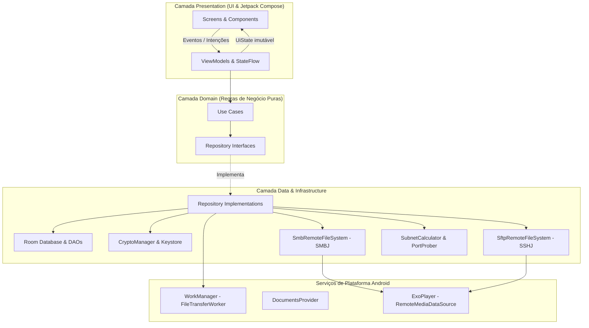

# 📡 SonarFiles

> **Gerenciador de arquivos de rede local (SMB v2/v3 e SFTP) para Android nativo**, desenvolvido com foco extremo em UX/UI minimalista, fluidez, alta performance assíncrona e segurança de nível de hardware.

[](https://kotlinlang.org)
[](https://developer.android.com/studio/releases/gradle-plugin)
[](https://developer.android.com/jetpack/compose)
[]()
[-brightgreen.svg)]()
[-blue.svg)]()

---

## 🎯 Visão Geral

O **SonarFiles** elimina a complexidade tradicional de protocolos de rede no Android. Em vez de telas áridas de configuração técnica, o aplicativo oferece uma interface limpa baseada em **Material Design 3** com suporte a **AMOLED True Black (`#000000`)** e acentos em ciano cyber (`#00E5FF`), permitindo varrer sua sub-rede local em busca de PCs Windows, servidores Linux, Raspberry Pis ou storages NAS com um visual inspirado em radares táticos.

---

## 🚀 Principais Recursos

### 1. 🔍 Scanner de Rede "Sonar" (Descoberta Ativa & Passiva)
- **Varredura Ultrarrápida da Sub-rede `/24`:** Conexões assíncronas via Kotlin Coroutines com concorrência balanceada (`Semaphore(48)` em `Dispatchers.IO`), evitando congestionamento no roteador ou esgotamento de descritores de arquivo (`EMFILE`).
- **Resolução de Serviços e Hostnames:**
  - Sondagem TCP direta nas portas **445/139 (SMB)** e **22 (SFTP/SSH)**.
  - Resolução NetBIOS Name Service (RFC 1002) via UDP 137 para identificar máquinas Windows e compartilhamentos Samba.
  - Descoberta mDNS em segundo plano com `NsdManager` (`_smb._tcp.`, `_sftp-ssh._tcp.`).
- **Radar Visual em Compose Canvas:** Animação fluida com ondas concêntricas pulsantes, feixe rotativo com `sweepGradient` e cards de hosts descobertos emitidos em tempo real via `Flow`.

### 2. 🗄️ Abstração Unificada de Arquivos (Strategy Pattern)
- A camada de apresentação e os casos de uso comunicam-se exclusivamente através da interface [`RemoteFileSystem`](app/src/main/java/com/sonarfiles/app/domain/repository/RemoteFileSystem.kt), tornando a interface totalmente agnóstica do protocolo subjacente:
  - **SMB (Windows / Samba):** Baseado na biblioteca `SMBJ` (suporte a dialetos SMB 2.0.2 até 3.1.1, autenticação NTLMv2, assinatura e DFS).
  - **SFTP (Linux / SSH):** Baseado na biblioteca `SSHJ` (autenticação por senha ou chave privada RSA/Ed25519 e verificação de host keys TOFU - *Trust On First Use*).
- **Pool de Conexões Inteligente (`ConnectionPoolManager`):** Reutilização de sessões ativas com keep-alive e encerramento de conexões ociosas.

### 3. 🔐 Segurança de Nível Militar & Biometria
- **Android Keystore (AES-256-GCM):** Senhas e chaves privadas nunca são expostas em texto plano. As chaves criptográficas mestras residem no chip de segurança do dispositivo (hardware-backed).
- **Desbloqueio com Biometria:** Integração com `BiometricPrompt` (`BIOMETRIC_STRONG` ou credenciais do dispositivo), permitindo proteger os servidores salvos sem atrito.
- **Limpeza de Memória:** Arrays de caracteres de senha preenchidos com `\u0000` após o uso.

### 4. 📂 Explorador de Arquivos Moderno
- **Barra de Breadcrumbs Interativa:** Caminho hierárquico rolável (`Raiz > Compartilhamento > Pasta > Subpasta`) com auto-scroll e salto direto para qualquer nível.
- **Alternância List View / Grid View:** Cards com ícones inteligentes diferenciados por tipo e extensão (Imagens, Vídeos, Áudio, Documentos/PDF, Códigos, Arquivos Compactados).
- **Operações Completas:** Criar pastas, renomear, excluir (com confirmação segura), buscar em tempo real e alternar arquivos ocultos.
- **Controle de Navegação Nativo:** `BackHandler` com gerenciamento de pilha (`pathStack`).

### 5. ⚡ Transferências em Background & Wake-on-LAN
- **WorkManager Foreground Service (`dataSync`):** Downloads e uploads resilientes mesmo com a tela bloqueada ou aplicativo em background, exibindo notificação com percentual, velocidade em tempo real (`MB/s`) e botão de cancelamento.
- **Wake-on-LAN (WoL):** Botão de energia rápido no card do servidor que envia o *Magic Packet* UDP para ligar remotamente seu computador desligado.
- **Streaming de Mídia sob Demanda:** [`RemoteMediaDataSource`](app/src/main/java/com/sonarfiles/app/service/streaming/RemoteMediaDataSource.kt) integrado ao Android Media3 (ExoPlayer), viabilizando reproduzir vídeos e áudios com suporte a seek sem download prévio.
- **Storage Access Framework (SAF):** Esqueleto preparado com [`SonarDocumentsProvider`](app/src/main/java/com/sonarfiles/app/service/provider/SonarDocumentsProvider.kt).

---

## 🏗️ Arquitetura do Software

O projeto segue estritamente a **Clean Architecture** com o padrão **MVVM + UDF (Unidirectional Data Flow)**:



---

## 📁 Estrutura de Diretórios

```text
SonarFiles/
├── settings.gradle.kts
├── build.gradle.kts
├── local.properties
├── gradle/
│   └── libs.versions.toml                     # Catálogo de versões e dependências do projeto
└── app/
    ├── build.gradle.kts
    ├── src/main/AndroidManifest.xml
    └── src/main/java/com/sonarfiles/app/
        ├── SonarFilesApp.kt                   # Inicialização do Hilt e BouncyCastle Provider
        ├── core/
        │   ├── common/                        # DispatchersProvider, ResultState, NetworkError
        │   ├── di/                            # Módulos Hilt (AppModule, DatabaseModule, RepositoryModule)
        │   ├── security/                      # CryptoManager (Keystore), BiometricAuthenticator, Vault
        │   └── ui/
        │       ├── components/                # RadarPulseAnimation, BreadcrumbBar, FileItemComponents
        │       └── theme/                     # Color (AMOLED), Type, Theme
        ├── domain/
        │   ├── model/                         # ServerConfig, RemoteFile, DiscoveredHost, TransferTask
        │   ├── repository/                    # RemoteFileSystem, NetworkScanner, Server, Transfer
        │   └── usecase/
        │       ├── scan/                      # ScanLocalNetworkUseCase, WakeOnLanUseCase
        │       ├── connection/                # TestConnectionDiagnosticUseCase, UnlockCredentials
        │       ├── explorer/                  # ListDirectoryUseCase, ManageRemoteFile, StreamRemoteFile
        │       └── transfer/                  # EnqueueTransferUseCase
        ├── data/
        │   ├── local/                         # Room Database, ServerDao, TransferHistoryDao, Entities
        │   ├── network/
        │   │   ├── client/                    # SmbRemoteFileSystem, SftpRemoteFileSystem, ConnectionPool
        │   │   └── scanner/                   # SubnetCalculator, PortProber, NetBiosResolver, WoL, mDNS
        │   └── repository/                    # Implementações de Server, Scanner, Credential, Transfer
        ├── service/
        │   ├── worker/                        # FileTransferWorker (ForegroundService dataSync)
        │   ├── streaming/                     # RemoteMediaDataSource (ExoPlayer Media3)
        │   └── provider/                      # SonarDocumentsProvider (SAF)
        └── presentation/
            ├── MainActivity.kt                # FragmentActivity + Compose Navigation Host
            ├── navigation/                    # ScreenRoutes (@Serializable) + SonarNavHost
            └── screens/
                ├── home/                      # Lista de servidores, atalhos WoL, status
                ├── sonar/                     # Radar tático e descoberta de rede em tempo real
                ├── server_form/               # Formulário manual e diagnóstico de conexão passo a passo
                ├── explorer/                  # Navegador de pastas, Breadcrumbs, Grid/List
                └── transfers/                 # Painel de transferências ativas e histórico
```

---

## 🛠️ Stack Tecnológica

| Componente | Tecnologia | Detalhes |
|---|---|---|
| **Linguagem** | Kotlin 2.1.0 | Recursos de concorrência com Coroutines e Flows reativos |
| **UI Framework** | Jetpack Compose | Material 3, Dynamic Colors e True Black AMOLED |
| **Injeção de Dependência** | Hilt (Dagger) 2.53.1 | `@HiltAndroidApp`, `@HiltViewModel` e `@HiltWorker` |
| **Navegação** | Navigation Compose 2.8.5 | Navegação segura Type-Safe com rotas `@Serializable` |
| **Persistência Local** | Room Database 2.6.1 | DAOs assíncronos retornando `Flow` e migração segura |
| **Tarefas em Background**| WorkManager 2.10.0 | Transferências com Foreground Service (`dataSync` API 34+) |
| **Protocolo SMB** | SMBJ 0.13.0 | Dialetos SMB 2.x e 3.x, autenticação NTLMv2 e DFS |
| **Protocolo SFTP** | SSHJ 0.39.0 | SSH v2, autenticação por senha/chaves e verificação TOFU |
| **Criptografia** | Android Keystore + BouncyCastle 1.79 | AES-256-GCM com chaves no hardware e provider BC unificado |
| **Biometria** | AndroidX Biometric 1.2.0 | Prompt biométrico com fallback de credencial de tela |
| **Mídia & Streaming** | AndroidX Media3 1.5.0 + Coil 3.0.4 | ExoPlayer com DataSource customizado e carregador de imagens |

---

## 📋 Pré-requisitos e Execução

### Requisitos Mínimos
- **Android Studio:** Ladybug (2024.2+) ou superior.
- **JDK:** Java 17 ou Java 21 (recomendado Eclipse Adoptium / Temurin).
- **Android SDK:** Compile SDK 35, Min SDK 26 (Android 8.0 Oreo ou superior).

### Como Compilar e Rodar
1. Clone ou abra a pasta [`SonarFiles`](file:///c:/Users/usuarioDM/Documents/Android/SonarFiles) no **Android Studio**.
2. Aguarde a sincronização inicial do Gradle (`Sync Project with Gradle Files`).
3. Conecte um dispositivo Android físico (recomendado para testes de rede local e biometria) ou inicie um Emulador configurado na mesma rede Wi-Fi.
4. Clique em **Run 'app'** (`Shift + F10`).

---

## 📄 Licença

Este projeto é disponibilizado sob a licença **MIT**. Veja o arquivo de licença para mais detalhes.
